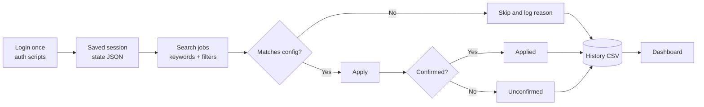

# JobPilot

> Automate your daily job applications on **Naukri** and **LinkedIn (Easy Apply)** with Python and Playwright, based on your own keywords, location, experience and freshness filters.

JobPilot runs locally on your machine. You log in once, it reuses your saved session, applies only to jobs that match your configuration, and records every decision in a CSV file that you can watch on a live dashboard.

## Table of Contents

- [Features](#features)
- [How It Works](#how-it-works)
- [Project Structure](#project-structure)
- [Setup](#setup)
- [Configuration](#configuration)
- [Usage: Naukri](#usage-naukri)
- [Usage: LinkedIn](#usage-linkedin)
- [Progress Dashboard](#progress-dashboard)
- [Demo Walkthrough](#demo-walkthrough)
- [History Statuses](#history-statuses)
- [Troubleshooting](#troubleshooting)
- [Security and Privacy](#security-and-privacy)
- [Disclaimer](#disclaimer)

## Features

- **Session reuse:** log in manually once (OTP/Captcha included); the session is saved and reused.
- **Dynamic search:** builds search URLs from keywords, multiple locations, freshness (`today`, `3_days`, `7_days`, `15_days`) and years of experience.
- **Strict matching:** applies only to jobs whose title/skills match the keyword, whose experience range fits yours, and whose location and posting age match. Everything else is skipped with a reason.
- **Safe skipping:** ignores jobs already in history, external "Apply on company site" jobs, and jobs with no direct apply button.
- **Questionnaires:** fills simple questions from default answers; abandons complex ones.
- **Rate limiting:** random 3-7 second human-like delays and a per-run application cap.
- **Verified results:** an application is recorded as `Applied` only after the site confirms it.
- **Tracking:** one CSV per platform (`Job Title`, `Company`, `URL`, `Date Applied`, `Status`) and a live dashboard that reads both.
- **Two independent runners:** Naukri and LinkedIn run as separate scripts.

## How It Works



## Project Structure

| File | Purpose |
|------|---------|
| `config.py` | Keywords, location, freshness, experience, limits, delays, defaults |
| `auth.py` | One-time manual login; saves the session |
| `main.py` | Search URL builder, CLI arguments, run orchestration |
| `automation.py` | Playwright search, apply and questionnaire logic |
| `tracker.py` | Reads/writes `applications_history.csv` |
| `logger.py` | Console and `jobapp.log` logging |
| `app.py` | Naukri entry point |
| `linkedin_auth.py` | One-time LinkedIn login; saves `linkedin_state.json` |
| `linkedin_automation.py` | LinkedIn Easy Apply search/apply logic |
| `linkedin_app.py` | LinkedIn entry point (separate run) |
| `dashboard.py` / `dashboard.html` | Local progress dashboard reading both CSV files |

Files created at runtime (git-ignored): `naukri_state.json`, `linkedin_state.json`, `applications_history.csv`, `linkedin_history.csv`, `jobapp.log`, `linkedin.log`.

## Setup

Requires Python 3.10+ and Windows, macOS or Linux.

```powershell
git clone <your-repo-url>
cd jobpilot
python -m venv .venv
.venv\Scripts\activate        # macOS/Linux: source .venv/bin/activate
pip install -r requirements.txt
playwright install chromium
```

## Configuration

All preferences live in [config.py](config.py). Command-line options override them for a single run.

| Setting | Meaning |
|---------|---------|
| `KEYWORDS` | Job searches to run, e.g. `"React.js Fresher"` |
| `LOCATION` | Comma-separated cities; empty for any |
| `FRESHNESS` | `today`, `3_days`, `7_days` or `15_days` |
| `EXPERIENCE_YEARS` | Your experience in years (0, 0.5, 4, 12, ...) |
| `EXPERIENCE_TOLERANCE_YEARS` | Skip jobs whose upper experience bound exceeds yours by more than this |
| `MAX_APPLICATIONS_PER_RUN` | Naukri cap per run (`LINKEDIN_MAX_APPLICATIONS_PER_RUN` for LinkedIn) |
| `MIN_DELAY_SEC` / `MAX_DELAY_SEC` | Random delay range between actions |
| `HEADLESS` | Keep `False`; both sites block headless browsers |
| `DEFAULT_ANSWERS` | Answers used for simple questionnaire fields |

## Usage: Naukri

1. Log in once:
   ```powershell
   python auth.py
   ```
   Log in in the opened browser (solve OTP/Captcha), then press Enter in the terminal. This creates `naukri_state.json`.

2. Edit [config.py](config.py) with your keywords, location, freshness and experience.

3. Run:
   ```powershell
   python app.py
   ```

4. Follow progress with the [dashboard](#progress-dashboard) or `Get-Content jobapp.log -Wait -Tail 20`.

Example with overrides:

```powershell
python app.py --keywords ".NET Core" "Full Stack Developer" --location "Pune, Noida" --freshness 3_days --experience 4 --max 10
```

| Option | Values |
|--------|--------|
| `--keywords` | One or more search phrases |
| `--location` | Comma-separated cities; empty for any |
| `--freshness` | `today`, `3_days`, `7_days`, `15_days` |
| `--experience` | Your years of experience (e.g. 0, 0.5, 4, 12) |
| `--headless` / `--no-headless` | Background / visible browser window |
| `--max` | Max applications this run |

## Usage: LinkedIn

Separate run with its own history (`linkedin_history.csv`) and log (`linkedin.log`).

```powershell
python linkedin_auth.py   # one-time login
python linkedin_app.py    # run
python linkedin_app.py --keywords "React Developer" --location "Pune, Noida" --freshness 7_days --experience 2 --max 5
```

- Takes the same options as the Naukri run.
- Searches Easy Apply jobs only; the LinkedIn experience-level filter is derived from `EXPERIENCE_YEARS`.
- Skips by title keyword, seniority words (`LINKEDIN_EXCLUDE_TITLE_WORDS`) and years of experience mentioned in the description.
- Keep the application cap low; LinkedIn restricts accounts aggressively.

## Progress Dashboard

```powershell
python dashboard.py
```

Opens `http://127.0.0.1:8000` with counts per status, a platform filter (Naukri / LinkedIn), search, and a job table with links. It refreshes every 5 minutes and is served only on your own machine.

## Demo Walkthrough

1. Show [config.py](config.py): set one keyword, one location, `MAX_APPLICATIONS_PER_RUN = 3`.
2. Run `python auth.py` and log in (skip if already done).
3. Start `python dashboard.py` in one terminal and `python app.py` in another.
4. Watch the log lines (`Checking: ...`, `Applied 1/3`, `Skipped - Keyword Mismatch`) and the dashboard counts.
5. Open an `Applied` job link to confirm the site shows it as applied.

## History Statuses

Both CSV files use these statuses:

`Applied`, `Already Applied`, `Skipped - External`, `Skipped - No Apply Button`, `Skipped - Questionnaire`, `Skipped - Keyword Mismatch`, `Skipped - Experience Mismatch`, `Skipped - Location Mismatch`, `Skipped - Freshness Mismatch`, `Skipped - Seniority Mismatch` (LinkedIn), `Unconfirmed`, `Error` (errors are retried on the next run).

## Troubleshooting

- **Session expired / redirected to login:** run `python auth.py` (or `python linkedin_auth.py`) again.
- **No jobs found or nothing applied:** sites change their markup often; update the selectors at the top of `automation.py` / `linkedin_automation.py`.
- **"Access Denied" in the log:** headless mode is blocked; keep `HEADLESS = False`.
- **Freshness filter not working (Naukri):** set `FRESHNESS_PARAM` in `config.py` to `"fgn"`.
- **Too many valid jobs skipped for experience:** raise `EXPERIENCE_TOLERANCE_YEARS`.
- **Too slow:** lower `MIN_DELAY_SEC` / `MAX_DELAY_SEC` (higher ban risk).
- Logs: `jobapp.log` (Naukri), `linkedin.log` (LinkedIn).

## Security and Privacy

- `naukri_state.json` and `linkedin_state.json` contain your logged-in session cookies. Anyone with them can access your accounts. They are listed in `.gitignore`; never commit or share them.
- The history CSVs and logs contain your application data and are also git-ignored.
- The dashboard binds to `127.0.0.1` only.

## Disclaimer

This project is for personal, educational use. Automating actions on Naukri or LinkedIn may violate their terms of service and can lead to account restrictions. Use your own account, keep caps and delays conservative, and use at your own risk. The authors are not affiliated with Naukri or LinkedIn.
